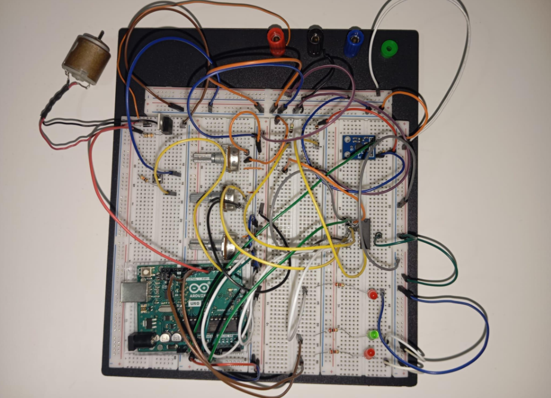
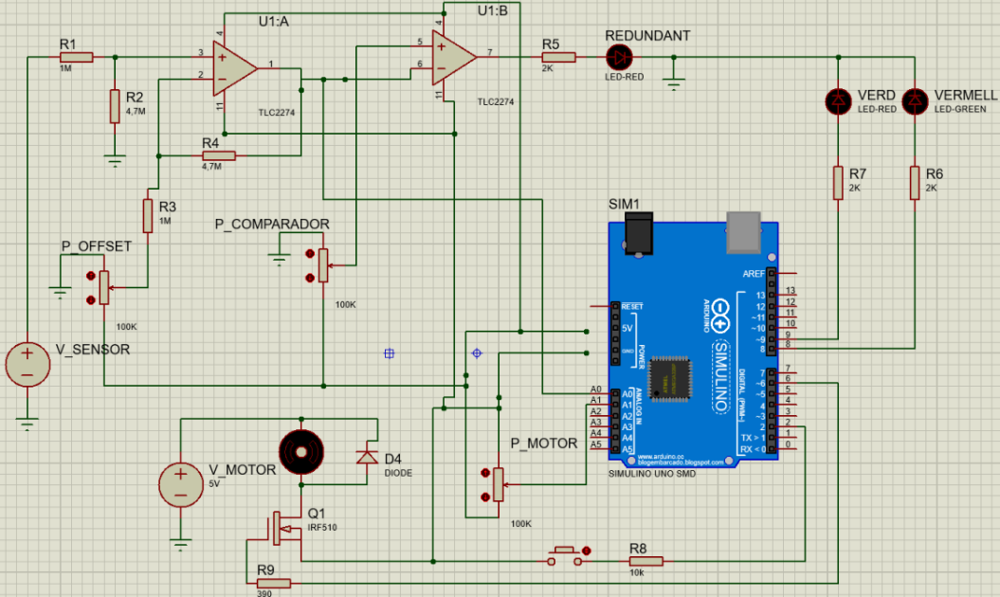

# Inclination Detection System

An Arduino-based inclination detection prototype using an ADXL335 accelerometer, analog signal conditioning, visual indicators and a DC motor controlled through PWM.

The project was developed as part of an aerospace engineering project to detect an inclination-related acceleration threshold and activate a motor when the measured signal falls below the defined limit.

## Overview

The system uses an ADXL335 three-axis accelerometer to measure acceleration along the Z axis. The sensor signal is conditioned using an analog circuit before being read by an Arduino UNO.

The microcontroller compares the measured signal against a predefined threshold. LEDs indicate the system state, while a push button and a potentiometer provide control over the DC motor.

The technical report defines the threshold as 0.8 g, corresponding to approximately 3.58 V or 733 ADC counts at the Arduino input.

## Features

- Acceleration measurement using an ADXL335 accelerometer
- Analog signal conditioning and threshold-based detection
- Visual status indication using green and red LEDs
- DC motor control through PWM
- Motor activation toggle using a push button
- Motor speed adjustment using a potentiometer
- Serial output of raw ADC readings for monitoring

## Hardware

The documented prototype includes:

- Arduino UNO
- ADXL335 three-axis accelerometer
- Analog signal-conditioning circuit
- Green and red LEDs
- Push button
- Potentiometer
- MOV36 DC motor
- Motor-driving and protection components

## System Operation

The Arduino reads the conditioned sensor signal through analog input A0 and compares it with the threshold of 733 ADC counts.

- **Below the threshold:** The red LED turns on. The motor can operate if enabled by the push button.
- **At or above the threshold:** The green LED turns on and the motor is stopped.
- **Motor speed:** A potentiometer connected to A1 adjusts the PWM output on digital pin 6.
- **Serial monitoring:** The raw sensor ADC reading is transmitted at 9600 baud.

## Hardware Implementation

### Physical Prototype

The following image documents the physical Arduino wiring and component connections.

### Circuit Design

The following image shows the circuit design prepared in Proteus.

## Pin Configuration

| Arduino pin | Function |
|---|---|
| A0 | Conditioned accelerometer signal |
| A1 | Potentiometer input |
| D2 | Push button |
| D6 | DC motor PWM control |
| D8 | Green LED |
| D9 | Red LED |

## Arduino Code

The Arduino sketch is available in:

`Arduino/InclinationDetectionSystem.ino`

The code uses the Arduino core functions for analog input, digital input/output, PWM control and serial communication.

## Running the Project

1. Open the Arduino sketch in the Arduino IDE.
2. Select the Arduino UNO board and the appropriate serial port.
3. Connect the circuit according to the project's hardware documentation.
4. Upload the sketch to the board.
5. Open the Serial Monitor at 9600 baud to observe the raw ADC readings.
6. Use the push button and potentiometer to control the motor when the sensor reading is below the configured threshold.

## Potential Application

The technical report discusses the potential use of this type of threshold-based detection and actuation system in drone stabilization.

The documented hardware is an educational prototype, not a flight-ready stabilization system.

## Technologies

- Arduino UNO
- Embedded C/C++ (Arduino sketch)
- Analog signal conditioning
- Accelerometer interfacing
- PWM motor control
- Proteus circuit design

## Contributors

* **Àlex Coromina Sayós** - [@alexcorominasayos](https://github.com/alexcorominasayos)
* **Adrià Expósito Casas** - [@adriaexposito-png](https://github.com/adriaexposito-png)
* **Jordán Frank Soto Huarcaya** - [@jordanfranksoto-netizen](https://github.com/jordanfranksoto-netizen)

## License

**MIT**